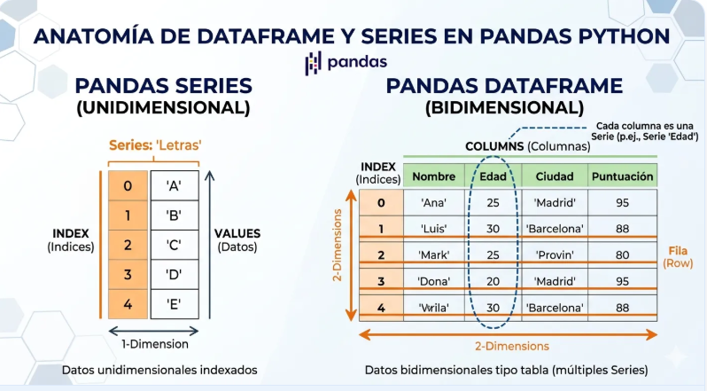
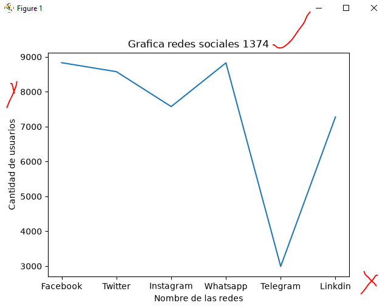
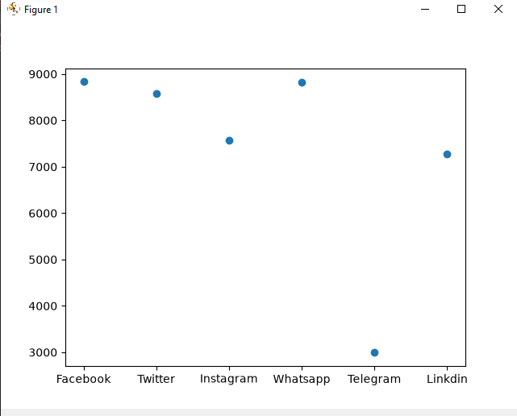
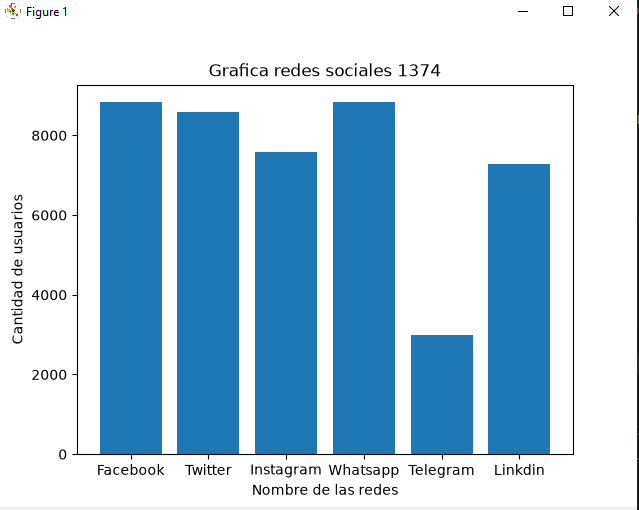
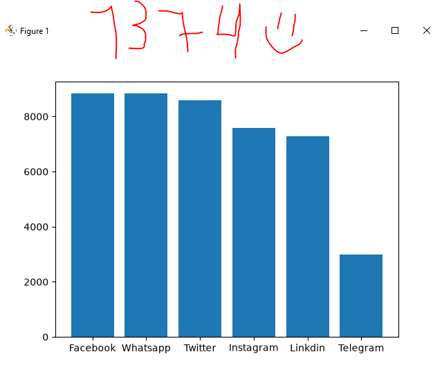
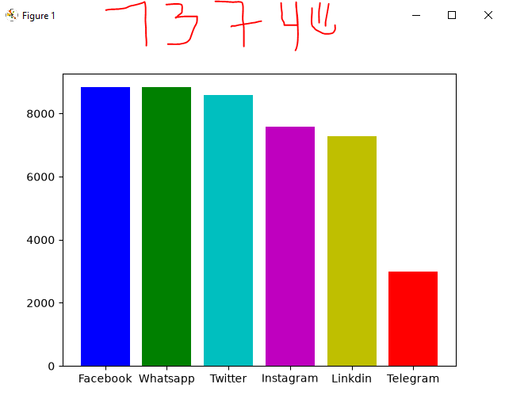
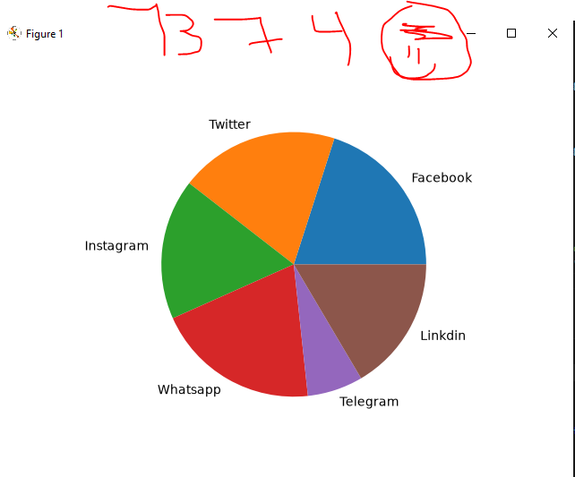

## dataframe o marco de datos pandas

## resdes sociales a nivel mundial 

## Grafuca lineal de redes sociales

## Grafica puntual de redes sociales 

## grafica de barras redes sociales 

## Grafica de barras del mas chico Decencente

## Grafica de barrar de colores 

## grafica de pastel o pie 
